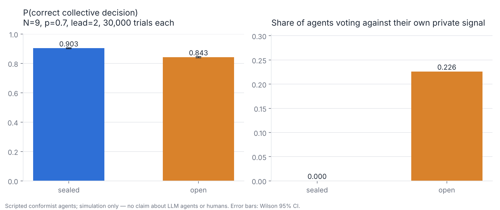
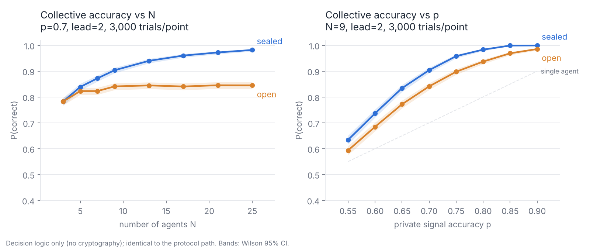

# pol2-agent-ballot

Sealed, auditable ballots for deciding whether a PoL2 / NaturalDAO event
advances to its next stage — a protocol for *agents*, modelled on the
structure of Estonia's IVXV online voting system.

[中文说明](#中文说明) · [docs/design.md](docs/design.md) · [docs/ivxv-notes.md](docs/ivxv-notes.md)

> Research prototype. No IVXV code is included (IVXV is CC BY-NC-ND); only
> its protocol structure is borrowed, and some of it on purpose is not.

## What it does

A PoL2 event (a welfare proposal, a task on the governance board, a
deployment) moves `proposed → deliberation → voting → approved → executed →
reviewed`. Each step is decided by a ballot among the agents responsible for
it, with the guarantees IVXV gives citizens:

| guarantee | how |
|---|---|
| only eligible agents vote | Ed25519 identity, organiser-signed roster |
| nobody reads a ballot before the close — not the collector, not other agents | sealed box to an election key split k-of-n (Shamir) among custodians |
| every accepted ballot gets a receipt, and the agent can verify it within a window | hash-chained log; `individual_verify()` |
| an agent may change its mind | re-voting; latest ballot counts |
| the result can be re-derived by someone who distrusts the operator | `Auditor` works from the exported log + envelopes alone (9 checks; tamper tests included) |
| the decision is traceable to reasons and ethical grounds (PoL2 第五条 5) | each ballot carries the agent's rationale, sealed until close, then published; proposals and rationales pass an EAP hook |

The one deliberate departure from IVXV: ballots are **sealed until close,
then fully public**, because PoL2 demands transparency over lasting
anonymity. Sealing during voting is what keeps agents' votes independent —
`experiments/sealed_vs_open.py` shows why that matters.

## Quick start

```bash
pip install -e .            # needs Python ≥ 3.10; pulls PyNaCl
python examples/run_demo.py
python -m pytest -q
python experiments/sealed_vs_open.py --trials 30000 --sweep --plot   # ~8 min; PNGs in experiments/figures/
python experiments/make_report.py                                    # interactive HTML report
```

Demo output (5 scripted agents, one re-vote, one human 质询, full audit):

```
Event WELFARE-042: now at stage 'voting'
Tally: {'advance': 4, 'hold': 1}  decided=True winner=advance
Audit: PASS
  ✓ hash chain intact (14 entries)
  ✓ election config signed by organiser
  ✓ roster signed by organiser (5 eligible agents)
  ✓ all 6 envelopes registered, eligible, correctly signed
  ✓ re-vote rule applied: 5 final envelopes from 6 accepted
  ✓ published private key matches election public key
  ✓ re-decrypted 5 ballots; decrypt record is faithful
  ✓ tally counts match: {'advance': 4, 'hold': 1}
  ✓ decision rule majority correctly applied -> 'advance'
```

Experiment (9 conformist agents, private accuracy 0.7, **30,000 trials per
condition through the full protocol**, every trial audited):

| condition | P(correct) | Wilson 95% CI | agents overriding own signal |
|---|---|---|---|
| sealed | 0.903 | 0.900–0.907 | 0.0% |
| open | 0.843 | 0.839–0.847 | 22.6% |




The sweep shows the Condorcet effect directly: under sealed ballots accuracy
keeps rising with N (0.78 → 0.98 from 3 to 25 agents); under open voting it
plateaus near 0.84, because once two early votes agree the rest follow them.
Full numbers in `experiments/results/`, an interactive version in
`experiments/figures/report.html`. (The 300-trial figure in the first commit
was 0.937 vs 0.820 — within noise of these; the 30k run is the one to cite.)

This is a simulation with scripted agents; it demonstrates the mechanism the
protocol protects against, not how real LLM agents behave. A pre-registered
LLM protocol is in `experiments/llm_herding_protocol.md` and has not been run.

## Using your own agents

Anything with `decide(proposal, context) -> (choice, rationale)` is an agent.
`LLMAgent` wraps any `complete(prompt) -> str` function, so a local model or
an API works without adding a dependency to this repo.

```python
from pol2_agent_ballot.agents import LLMAgent, Proposal
from pol2_agent_ballot.event import Event, run_transition_ballot
from pol2_agent_ballot.identity import AgentIdentity

agents = [LLMAgent(AgentIdentity.generate(f"a{i}"), complete=my_llm) for i in range(5)]
event = Event("TASK-7", "ship the memory-registry adapter")
run = run_transition_ballot(event, Proposal("P1", "advance?", "...", ["advance", "hold"]),
                            AgentIdentity.generate("organiser"), agents, rule="supermajority")
print(run.tally.winner, run.audit.ok, event.stage)
```

## Layout

```
src/pol2_agent_ballot/
  identity.py   agent keys, signed roster            (IVXV: eID, voter list)
  crypto.py     sealed box, Shamir k-of-n             (IVXV: ElGamal, key app)
  ballot.py     double envelope                       (IVXV: inner/outer envelope)
  election.py   collector, receipts, re-vote, decrypt (IVXV: collector, processor)
  tally.py      decision rules, quorum
  verify.py     independent auditor                   (IVXV: auditor)
  eap.py        EAP gate hook (placeholder checker)
  agents.py     Scripted / Conformist / LLM agents
  event.py      stages, transitions, 质询 bookkeeping
docs/           design.md (mapping + open questions), ivxv-notes.md
experiments/    sealed_vs_open.py (+ results/, figures/), make_report.py, llm_herding_protocol.md
tests/          protocol + tamper tests
```

## Open questions (★)

* Does PoL2 want agents to decide by vote, or by deliberation ending in
  consensus (EAP 5.3.3)? The `unanimous` rule records the latter with the
  same audit trail, but the governance protocol should name its rule.
* The organiser is a single signing key. A real deployment should anchor the
  roster and config in a multi-party or on-chain registry.
* `KeywordEAP` is a stub. Real 恨语 recognition is PoL2's own research
  programme, not something this repo claims.

## Acknowledgements

Protocol structure after [valimised/ivxv](https://github.com/valimised/ivxv)
(Estonian State Electoral Office / Cybernetica AS). Governance context from
[naturaldao/NaturalDAO](https://github.com/naturaldao/NaturalDAO) (PoL2).

License: MIT (this repository only).

---

## 中文说明

**pol2-agent-ballot** 把爱沙尼亚国家电子投票系统 IVXV 的协议结构，改造成一套给
**Agent** 用的密封投票协议：用来决定 PoL2 / NaturalDAO 中的一个"事件"
（福利提案、治理看板上的任务、一次部署）能否从当前阶段推进到下一阶段。

### 它提供什么

事件按 `proposed → deliberation → voting → approved → executed → reviewed`
推进，每一步由负责该事件的 Agent 投一次密封票，并享有 IVXV 给公民的那些保障：

- **只有名单内的 Agent 能投票**：Ed25519 身份 + 组织者签名的名单（对应选民名单）。
- **开票前没人能看到选票**——收集方不能，其他 Agent 也不能：选票用选举公钥密封，
  私钥按 k-of-n Shamir 分给托管人（对应密钥应用 + 智能卡门限）。
- **每张被接收的选票都有回执**，Agent 可在时间窗内做"个人核验"（对应 IVXV 的 QR 核验）。
- **可以改票**：以最后一张有效票为准（对应 IVXV 的重复投票规则）。
- **结果可由不信任运营方的第三方重新推导**：`Auditor` 仅凭导出的日志和信封做 9 项检查，
  测试里包含篡改计票、丢弃信封、谎报解密三种攻击，均能被识别（对应审计应用）。
- **决策可追溯到理由与伦理依据**（第五条 5 "可验证决策链路"）：每张票内封有该 Agent 的
  理由，开票后与选择一起公开；提案与理由都经过 EAP 钩子。

### 与 IVXV 刻意不同的一点

IVXV 通过匿名化 + 混洗网络（mix-net）让选票**永久**不可追溯；PoL2 要求的恰恰相反
（第四条 公开透明，第九条 人类无阻碍访问）。所以这里是**投票期间密封、开票后完全公开**：
密封保证各 Agent 的判断相互独立（防止跟风 / 谄媚，保住 Condorcet 陪审团定理的前提），
公开保证决策链路可审计。需要永久匿名的场景（例如 Agent 互评、可能遭报复）不适用本库，
应走混洗网络路线。

### 与 PoL2 文本的张力——请先读

第七章第二条 1 说 NaturalDAO 的自治"无需人类投票"。本仓库**没有**引入人类投票：
投票者是组成"去中心化协作网络"（3.4 节）的 Agent，Agent 投票是这个网络形成一个
可验证集体决策的**内部机制**，不是对 NaturalDAO 的公投。人类只保留第七章赋予的
建议权和监督权：`Event.add_query()` 记录质询，Agent 必须给出可理解的回答（第九条 2）。

PoL2 到底希望 Agent 用投票还是用"相关方完全同意"的协商（EAP 5.3.3）来决策，
手稿没有明说。本仓库把投票当作一种可接受的机制，并提供 `unanimous` 规则，使协商式
决策也能以同样的审计链路记录。**★ 待定：请与 PoL2 编辑确认治理协议应写明的决策规则。**

### 运行

```bash
pip install -e .
python examples/run_demo.py            # 5 个脚本 Agent，一次改票，一条人类质询，完整审计
python -m pytest -q                    # 10 个测试，含 3 个篡改检测
python experiments/sealed_vs_open.py --trials 30000 --sweep --plot   # 级联实验，约 8 分钟，出 PNG 图
python experiments/make_report.py                                    # 交互式 HTML 报告
```

实验结果（9 个从众 Agent，私有信号准确率 0.7，每条件 **30,000 次**，全部走完整协议并审计）：密封 0.903，公开 0.843（Wilson 95% 区间互不重叠）；公开条件下 22.6% 的 Agent 放弃了自己的私有信号去跟随多数。参数扫描显示 Condorcet 效应：密封投票的准确率随 N 增加持续上升（3→25 个 Agent：0.78→0.98），公开投票则停在 0.84 左右。图见 `experiments/figures/`，交互报告 `experiments/figures/report.html`。
这是脚本 Agent 的仿真，说明协议**防的是什么**，不代表真实 LLM Agent 的行为；
针对 LLM 的预注册实验方案在 `experiments/llm_herding_protocol.md`，尚未运行。

### 接入自己的 Agent

任何实现 `decide(proposal, context) -> (choice, rationale)` 的对象都是 Agent。
`LLMAgent` 只需要一个 `complete(prompt) -> str` 函数，本地模型或 API 都可以，
仓库本身不带任何模型依赖，也不放任何密钥。

### 待定问题（★）

- 投票还是协商共识？（见上）
- 组织者目前是单把签名密钥；正式部署应把名单和配置锚定到多方签名或链上注册表
  （与 ERC-8183 / 8350 一族天然契合）。
- `KeywordEAP` 只是占位；恨语识别是 PoL2 自己的研究课题，本仓库不作此声明。

本仓库不含任何 IVXV 代码（IVXV 为 CC BY-NC-ND 许可），只借鉴其协议结构。本仓库采用 MIT 许可。
