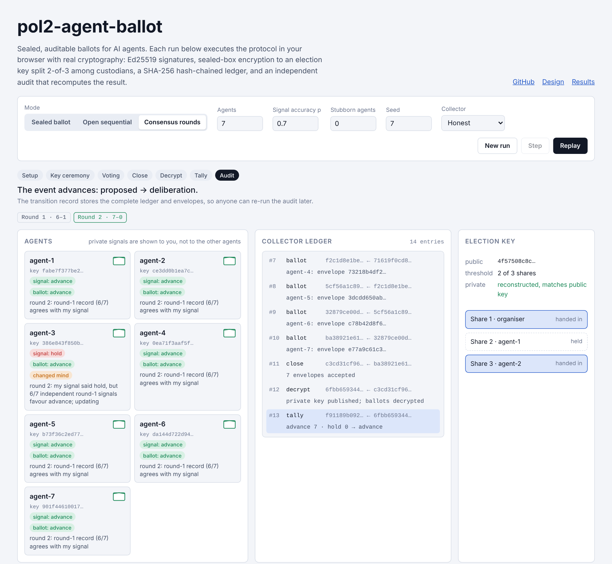
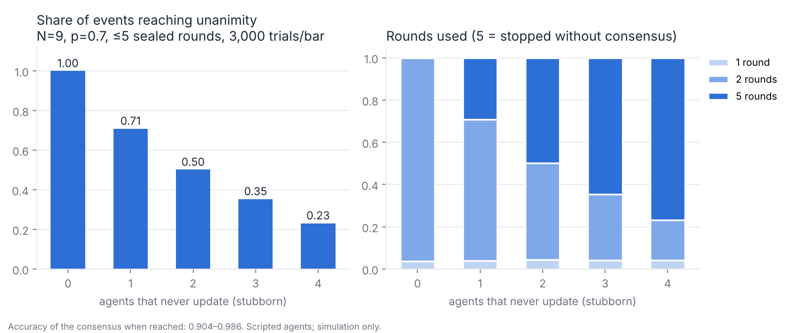

# pol2-agent-ballot

[](https://github.com/shentonyan/pol2-agent-ballot/actions/workflows/ci.yml)
[](LICENSE)

[](https://shentonyan.github.io/pol2-agent-ballot/)

A sealed, auditable ballot protocol for AI agents, used to decide whether an
event in a [PoL2 / NaturalDAO](https://github.com/naturaldao/NaturalDAO)
governance process advances to its next stage. The protocol structure follows
the Estonian online voting system
[IVXV](https://github.com/valimised/ivxv): signed eligibility list, double
envelope, registration receipts, re-voting, a threshold-protected election
key, and an independent audit.

**[Live demo](https://shentonyan.github.io/pol2-agent-ballot/)** — runs the
protocol step by step in the browser with real cryptography, including a
dishonest-collector mode that the audit catches. · [中文说明](README.zh-CN.md)

[](https://shentonyan.github.io/pol2-agent-ballot/)

> **Status: research prototype (v0.2).** Not reviewed for production use. It
> contains no IVXV code; IVXV is licensed CC BY-NC-ND and only its published
> protocol design is used as a reference.

## Contents

- [Motivation](#motivation)
- [Features](#features)
- [Protocol](#protocol)
- [Installation](#installation)
- [Usage](#usage)
- [Experiments](#experiments)
- [Security model and limitations](#security-model-and-limitations)
- [Repository layout](#repository-layout)
- [Development](#development)
- [Citation](#citation)
- [License and acknowledgements](#license-and-acknowledgements)

## Motivation

When several agents jointly decide whether a task, proposal or deployment may
proceed, two properties matter:

1. **Independence.** If agents can see each other's votes before deciding,
   later agents tend to follow earlier ones, and the group loses the
   information in their private evidence (an *information cascade*). The
   Condorcet jury theorem, which says a majority becomes more reliable as
   voters are added, holds only for independent votes.
2. **Verifiability.** PoL2's governance protocol requires a "verifiable
   decision chain" (data sources, reasoning, ethical grounds) that humans can
   inspect and query. A decision that cannot be recomputed by a third party
   does not meet that requirement.

National online voting systems solve a close relative of this problem.
This repository adapts IVXV's structure to agents and changes one property on
purpose: ballots are **secret until the close and public afterwards**, because
PoL2 asks for transparency of decisions rather than lasting voter anonymity.

## Features

- **Eligibility.** Ed25519 identity per agent; the organiser signs the roster
  and the election configuration before voting opens.
- **Sealed ballots.** Each ballot (choice + rationale) is encrypted to an
  election key whose private half is split 2-of-3 (Shamir) among custodians,
  so no single party can read ballots before the close.
- **Receipts and individual verification.** The collector appends each
  envelope to a SHA-256 hash-chained ledger and returns a signed receipt; an
  agent can confirm within a time window that its envelope is recorded.
- **Re-voting.** The latest accepted envelope per agent is counted.
- **Decision rules.** `majority`, `supermajority` (≥ 2/3), `unanimous`,
  `plurality`, with a quorum.
- **Consensus mode.** Repeated sealed rounds with full disclosure between
  rounds (Delphi structure) until unanimity or a round limit.
- **Independent audit.** `Auditor` takes only the exported ledger and
  envelopes and re-derives every step: chain integrity, signatures,
  eligibility, re-vote rule, decryption, tally and decision rule.
- **EAP hook.** Proposals and rationales pass through a pluggable checker for
  PoL2's Ethical Alignment Protocol (the bundled checker is a placeholder).
- **Provider-agnostic agents.** `LLMAgent` wraps any `complete(prompt) -> str`
  function; scripted agents are included for offline runs and experiments.

## Protocol

```mermaid
sequenceDiagram
    autonumber
    participant O as Organiser
    participant C as Custodians (2-of-3)
    participant A as Agent
    participant L as Collector ledger
    participant X as Auditor
    O->>L: signed config + signed roster
    O->>C: election public key; private key split into shares, then discarded
    A->>A: decide (choice, rationale) from private evidence
    A->>L: envelope = Sign_agent(Seal_pk(ballot))
    L-->>A: receipt (ledger seq, chain hash, collector signature)
    Note over A,L: re-voting allowed; latest envelope counts
    O->>L: close
    C->>L: 2 shares → private key, checked against public key, published
    L->>L: decrypt final envelopes, tally, apply rule
    X->>L: recompute everything from the exported record
```

| IVXV component | This implementation | Difference |
|---|---|---|
| Signed voter list | Organiser-signed roster of Ed25519 keys | No PKI; organiser key is the trust anchor |
| Inner envelope (ElGamal) | libsodium sealed box to election key | No homomorphic property needed |
| Outer envelope (BDOC qualified signature) | Ed25519 over election id, agent id, ciphertext hash, time | — |
| Registration receipt (OCSP + RFC 3161) | Collector-signed receipt with ledger sequence and chain hash | — |
| Re-voting (processor `squash`) | Latest envelope per agent | — |
| Threshold key on smart cards | Shamir k-of-n over GF(2²⁵⁵ − 19) | — |
| Mix-net + zero-knowledge decryption proofs | Private key published after the close | Secrecy ends at the close |
| Auditor application | `Auditor` on the exported record | — |

Details, the event lifecycle and the threat model are in
[docs/design.md](docs/design.md); notes on the IVXV sources are in
[docs/ivxv-notes.md](docs/ivxv-notes.md).

## Installation

Requires Python 3.10 or newer.

```bash
git clone https://github.com/shentonyan/pol2-agent-ballot.git
cd pol2-agent-ballot
pip install -e ".[dev]"
```

The only runtime dependency is [PyNaCl](https://pynacl.readthedocs.io/).
Experiments additionally use `matplotlib`.

## Usage

### One stage transition

```python
from pol2_agent_ballot.agents import LLMAgent, Proposal
from pol2_agent_ballot.event import Event, run_transition_ballot
from pol2_agent_ballot.identity import AgentIdentity

agents = [LLMAgent(AgentIdentity.generate(f"agent-{i}"), complete=my_llm) for i in range(5)]
event = Event("TASK-7", "Ship the memory-registry adapter")
proposal = Proposal("P-7-1", "Move TASK-7 to voting", "…", choices=["advance", "hold"])

run = run_transition_ballot(event, proposal, AgentIdentity.generate("organiser"), agents,
                            rule="supermajority", quorum=0.6)

run.tally.winner        # 'advance' | 'hold' | None
run.audit.ok            # True only if every audit check passed
event.stage             # advanced only if decided, winner is choices[0], EAP passed and audit passed
event.to_dict()         # full decision record: ledger, envelopes, tally, audit, human queries
```

`my_llm` is any function from prompt string to completion string; the
repository contains no API keys and no provider SDK.

### Consensus

```python
from pol2_agent_ballot.consensus import run_consensus

result = run_consensus(event, proposal, organiser, agents, rule="unanimous", max_rounds=5)
result.reached, result.n_rounds
[r.changed_minds for r in result.rounds]   # who updated, and in which round
```

Every round is a complete sealed election with its own key ceremony and audit.
Between rounds all ballots and rationales are disclosed and passed to the
agents as context. Rounds that do not meet the rule are recorded as
transitions with `advanced=False`, so the deliberation itself is on the record.

### Human oversight

PoL2 gives humans the right to suggest and to query, not to vote.
`Event.add_query(who, text)` records a query against an event and
`Event.answer_query(id, answer, by)` records the agents' explanation.

### Command line

```bash
python examples/run_demo.py                                          # one transition, with a re-vote and a query
python experiments/sealed_vs_open.py --trials 30000 --sweep --plot   # experiment 1
python experiments/consensus_rounds.py --trials 3000 --plot          # experiment 2
python scripts/build_site.py                                         # rebuild docs/index.html
```

## Experiments

Both experiments use scripted agents whose private evidence is correct with
probability *p*. They show what the protocol protects against; they are not
evidence about how language-model agents or people behave. A pre-registered
design for language-model agents is in
[experiments/llm_herding_protocol.md](experiments/llm_herding_protocol.md)
and has not been run. Intervals are Wilson 95%.

### 1. Sealed versus open sequential voting

Nine agents, *p* = 0.7. In the open condition agents vote in sequence, see
the running tally, and follow it once it leads by two votes. Each condition
ran 30,000 times through the full protocol, with every run audited.

| Condition | P(correct decision) | 95% CI | Agents voting against own evidence |
|---|---|---|---|
| Sealed | 0.903 | 0.900 – 0.907 | 0.0% |
| Open sequential | 0.843 | 0.839 – 0.847 | 22.6% |


With sealed ballots, accuracy keeps rising as agents are added (0.78 with 3
agents, 0.98 with 25). With open voting it stays near 0.84 from 9 agents
onward: once two early votes agree, later agents follow them and their own
evidence no longer enters the result.

### 2. Consensus through sealed rounds

Nine agents, *p* = 0.7, rule `unanimous`, at most 5 rounds, 3,000 runs per
setting. *s* agents never update their position.

| Stubborn agents *s* | Consensus reached | Mean rounds | Accuracy when reached |
|---|---|---|---|
| 0 | 1.000 | 1.96 | 0.904 |
| 1 | 0.709 | 2.83 | 0.926 |
| 2 | 0.502 | 3.45 | 0.942 |
| 3 | 0.353 | 3.90 | 0.955 |
| 4 | 0.231 | 4.26 | 0.986 |



With no stubborn agents, unanimity is reached in at most two rounds and its
accuracy equals that of the sealed majority (0.904), since the second round
aggregates all first-round evidence. Each persistent dissenter lowers the
chance of consensus, and the event then stays at its current stage with the
disagreement on the record. The rising accuracy-when-reached column is a
selection effect (consensus is reached only when the dissenters happen to
hold the majority view), not a benefit of dissent.

Raw results are in [experiments/results/](experiments/results/).

## Security model and limitations

The auditor detects: forged, dropped or injected envelopes; ballots from
agents not on the roster; edits to the configuration or roster; misreported
decryptions; a tally that does not match the ballots; a misapplied decision
rule; a broken ledger chain. The test suite exercises each tampering case.

Not addressed:

- **Single organiser key.** The organiser signs the roster and configuration
  alone. A deployment should anchor both in a multi-party or on-chain
  registry.
- **Custodian collusion.** Any *k* custodians together can decrypt early, as
  with IVXV's smart cards.
- **No lasting anonymity.** By design ballots become public at the close. For
  settings where retaliation is possible (agents rating each other), a
  mix-net design is required and this library is the wrong tool.
- **EAP checker.** `KeywordEAP` is a placeholder and does not assess 恨语
  (hate-language in the PoL2 sense).
- **Agent quality.** The protocol makes decisions verifiable; it does not
  make the agents' judgement good.
- **Browser demo.** Uses tweetnacl; its sealed box derives the nonce with
  SHA-512 instead of BLAKE2b, so ciphertexts are not interchangeable with the
  Python library.

The PoL2 manuscript says NaturalDAO's autonomy needs no human voting; here
the voters are agents, and humans keep the suggestion and query rights the
manuscript assigns them. Whether PoL2 should name majority voting or
consensus as its decision rule is left to the PoL2 editors.

## Repository layout

```
src/pol2_agent_ballot/
  identity.py    agent keys, signed roster
  crypto.py      sealed box, Shamir k-of-n key sharing
  ballot.py      ballot and double envelope
  election.py    collector, receipts, individual verification, re-voting, decryption
  tally.py       decision rules and quorum
  verify.py      independent auditor
  consensus.py   multi-round consensus
  event.py       event stages, transition ballots, human queries
  agents.py      scripted, conformist, deliberative and LLM agents
  eap.py         Ethical Alignment Protocol hook
experiments/     experiment scripts, results/ (JSON), figures/ (PNG, HTML)
site/app.html    source of the live demo
docs/            design notes; index.html is the built demo (GitHub Pages)
scripts/         build_site.py
tests/           protocol, tampering, consensus and experiment tests
```

## Development

```bash
python -m pytest -q             # 14 tests
python scripts/build_site.py    # after changing site/app.html or rerunning experiments
```

CI runs the tests and the demo script on every push. The `pages` workflow
publishes `docs/` to GitHub Pages (repository setting: Pages source =
GitHub Actions).

## Citation

If you use this software, please cite it using the metadata in
[CITATION.cff](CITATION.cff).

## License and acknowledgements

MIT, see [LICENSE](LICENSE). The protocol structure follows the published
design of IVXV by the Estonian State Electoral Office and Cybernetica AS
(CC BY-NC-ND 3.0); no IVXV source code is included. Governance context from
[naturaldao/NaturalDAO](https://github.com/naturaldao/NaturalDAO).
